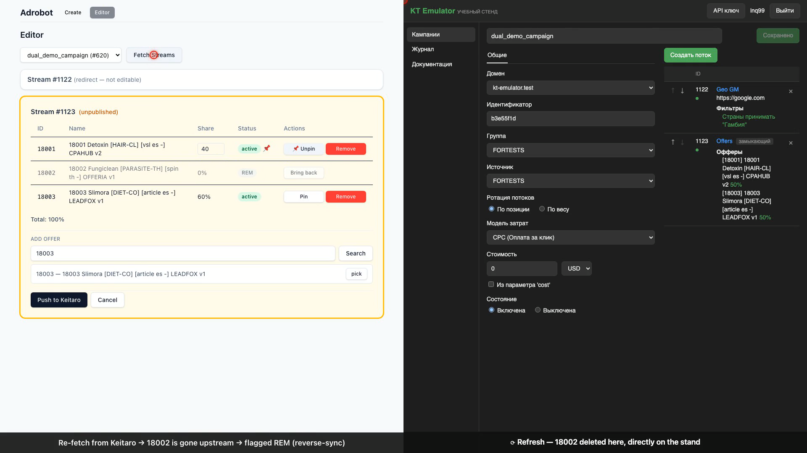

# Adrobot — Keitaro API wrapper

A wrapper around the [Keitaro](https://keitaro.io/) Admin API (ad-tracker / link
constructor), built for the Adrobot test task. Two parts:

1. **Campaign creator** — given `name`, `geo_code`, `offer_id`, create a campaign
   with two streams (geo → Google, and the chosen offer), using a configured
   domain / group / source.
2. **Campaign editor** — add/remove offers in an existing campaign with weight
   recalculation, draft/publish (push/cancel), archive, bring-back,
   reverse-sync (offers removed in Keitaro), and pinned weights.

> Stack: **FastAPI + SQLAlchemy 2.0 + Alembic + Postgres** backend;
> **React + TypeScript (Vite)** SPA frontend.

## Demo

<!-- INLINE PLAYER — GitHub renders a <video> player when a GitHub-hosted asset
     URL sits on its own line. To create one (can't be generated locally):
       1. Push this repo to GitHub.
       2. On GitHub, open a new Issue (or PR), drag `frontend/e2e/dual-demo-1080.mp4`
          into the comment box, and wait for the upload to finish.
       3. Copy the generated `https://github.com/user-attachments/assets/<id>` URL.
       4. Paste it on the blank line below — bare URL, its own line. No need to
          submit the issue.
     Notes: ~10 MB upload limit (the file is 1.6 MB); the player renders only on
     github.com (not in local/VS Code previews); GitHub shows play-button controls
     (it never autoplays). You can then delete the fallback thumbnail below. -->

<!-- ⬇ paste the GitHub video URL on the blank line directly below ⬇ -->


▶️ **[Full video — direct link](https://pub-56a06514013f448db8c808889cc73bff.r2.dev/dual-demo-1080.mp4)** · side-by-side: the Adrobot SPA (left) drives the **real** Keitaro stand while the KT emulator (right) reacts live — create campaign → auto-rebalance weights → pin %, add offers, **bring-back (local)**, and **reverse-sync** (an offer deleted directly in Keitaro, detected on fetch).

<!-- Fallback thumbnail (renders everywhere; click → full video). Remove once the inline player above is in place. -->
[](https://pub-56a06514013f448db8c808889cc73bff.r2.dev/dual-demo-1080.mp4)

## Status

Implemented. Backend: FastAPI + SQLAlchemy + Alembic, 44 service/API tests all green
(incl. a 500-case property/fuzz suite over the weight math).
Frontend: React + TypeScript SPA (Vite), deployed to GitHub Pages.

## Docs

| File | What |
|------|------|
| [`docs/task-ru.md`](./docs/task-ru.md) | Original task (RU) |
| [`docs/api-reference.md`](./docs/api-reference.md) | **Verified** test-stand API reference |
| [`docs/test-stand-ru.md`](./docs/test-stand-ru.md) | Test-stand (emulator) access notes |
| [`docs/admin-api.openapi.json`](./docs/admin-api.openapi.json) | Keitaro Admin API OpenAPI spec |
| [`docs/superpowers/specs/2026-11-26-adrobot-design.md`](./docs/superpowers/specs/2026-11-26-adrobot-design.md) | Design spec |
| [`docs/superpowers/plans/2026-11-26-adrobot-implementation.md`](./docs/superpowers/plans/2026-11-26-adrobot-implementation.md) | TDD implementation plan |

## Run

### 1. Database (Postgres via Docker)

```bash
docker compose up -d
```

> If local port 5432 is taken, set `PG_PORT` in `docker-compose.yml` and update
> `DATABASE_URL` in `backend/.env` to match.

### 2. Backend

```bash
cd backend
python3 -m venv .venv && . .venv/bin/activate
pip install -r requirements.txt
cp .env.example .env            # paste your Keitaro Api-Key
alembic upgrade head            # run migrations
uvicorn app.main:app --reload   # http://localhost:8000
```

### 3. Frontend

```bash
cd frontend
npm install
cp .env.example .env            # VITE_API_URL=http://localhost:8000
npm run dev                     # http://localhost:5173
```

### Tests

```bash
cd backend && . .venv/bin/activate && pytest
```

## Part 1 / Part 2

- **Create** tab: name + countries + offer → campaign with 2 streams (geo→Google, offer).
- **Editor** tab: pick a campaign → Fetch Streams → add/remove/pin offers,
  Push/Cancel. Yellow = unpublished; gray = removed (the badge's tooltip says whether
  it was removed locally or in Keitaro).

## How AI agents were used

This project was developed with Claude Code using a spec-driven workflow
(brainstorming → spec → plan → TDD). The resulting spec and implementation plan
are tracked under [`docs/superpowers/`](./docs/superpowers); the agent's project
instructions are in [`CLAUDE.md`](./CLAUDE.md).

AI agents were also used to:

- **Write the tests** — the backend pytest suite (44 service/API tests, TDD) and
  the Playwright end-to-end browser tests
  ([`frontend/e2e/`](./frontend/e2e)) that drive the real SPA against a demo backend.
- **Produce the video screencast** — the side-by-side [demo](#demo) above is
  generated by a Playwright harness
  ([`frontend/e2e/dual-record.dual.ts`](./frontend/e2e/dual-record.dual.ts)):
  it records the Adrobot SPA and the live Keitaro emulator as two panes, then
  composites them into one 1080p video with ffmpeg
  ([`frontend/scripts/merge-lr.sh`](./frontend/scripts/merge-lr.sh)) — captions,
  cursor/click overlays, and all.
